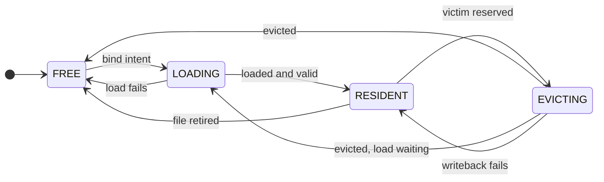

# 7. I/O and Buffer Management

## 7.1 Scope

This chapter defines the boundary between raw page-file I/O and database-managed resident pages.

It covers:

- `DiskManager` responsibilities,
- positional page I/O and file-size/error semantics,
- BufferPool ownership,
- resident-frame metadata,
- RAII page guards,
- resident-page lookup,
- pinning and eviction eligibility,
- dirty-page state,
- WAL-before-data enforcement,
- CLOCK replacement,
- lifetime safety for references into resident page bytes.

The BufferPool is intentionally storage-format agnostic: it manages pages, not tuples, indexes, schemas, or SQL semantics. The WAL-owned refinements to buffer metadata and flush publication are canonical in §§12.10, 12.12, and 12.16–12.17; redo and torn-page reconstruction are canonical in §§13.13–13.14.

## 7.2 Explicit I/O model

The baseline page-file path uses explicit positional I/O:

```text
pread
pwrite
fdatasync
```

Database pages are not primarily managed through `mmap`.

Explicit I/O keeps control over:

- page residency,
- replacement,
- dirty writeback,
- WAL-before-data ordering,
- page lifetime,
- prefetch and writeback policy within the ownership rules defined here.

Direct I/O, `io_uring`, asynchronous prefetch, and similar alternatives are outside the architecture baseline.

## 7.3 DiskManager responsibility boundary

`DiskManager` is deliberately ignorant of database logical/physical page contents.

It owns raw operating-system/file concerns including:

- database file paths,
- the open database-root/pending directory handles and managed namespace operations from §4.7,
- mapping database `FileId` values to open process-local handles,
- fixed-size page reads and writes,
- raw file creation/open/close,
- file-size discovery,
- raw durable file synchronization,
- explicit file extension.

It does **not** interpret:

- tuples,
- schemas,
- MVCC,
- B+ tree algorithms,
- SQL,
- query plans.

The exact C++ API is not part of the architecture contract.

The required responsibility shape is equivalent to:

```text
read one already-allocated page
write one already-allocated page
extend one managed page file by one page
synchronize a page file
open/create/register raw files
close raw files
inspect file size
```

WAL writing, durability scheduling, and `durable_lsn` advancement belong to the WAL writer/flusher. `DiskManager` provides lower-level file synchronization primitives but does not own transaction-level WAL durability coordination.

### 7.3.1 File lifecycle boundary

Creating an operating-system file and initializing a database file superblock are separate operations.

The raw disk layer MAY create/register an empty file, but it does not:

- choose `FileKind`,
- encode page `0`,
- interpret file-kind-specific metadata,
- establish higher-level persistent object identity.

A higher page-file/storage layer allocates and writes the superblock and performs persistent-format/identity validation.

The raw disk layer's create/rename/unlink calls do not themselves publish higher-level objects. The storage namespace owner composes regular-file synchronization and parent-directory synchronization through the canonical §4.7 lifecycle before reporting durable namespace publication.

`FileId` remains a database-level logical identifier. POSIX file descriptors are private process-local resources of the raw I/O layer and MUST NOT escape as persistent identity.

## 7.4 Page-file I/O semantics

### 7.4.1 Positional access

Page reads and writes use positional I/O. `pread` and `pwrite` MUST NOT depend on or mutate a shared file offset.

### 7.4.2 Complete page transfers

A normal page read requests exactly `PAGE_SIZE` bytes.

The I/O layer MUST handle short reads and writes explicitly; one syscall is not assumed to transfer all requested bytes.

For reads:

- EOF before the requested page begins is a missing-page error.
- EOF after only part of the page was transferred is a short-read/corruption-style I/O error.
- a failed read MUST NOT expose a partially initialized destination page as a valid page result.

For writes, the implementation MUST complete the full page transfer or return an error.

### 7.4.3 EINTR behavior

The following operations are retried when interrupted by `EINTR`, subject to their normal Linux semantics:

```text
pread
pwrite
fstat
ftruncate
fdatasync
fsync
```

`close` MUST NOT be blindly retried after `EINTR`, because the descriptor may already have been released and reused.

### 7.4.4 Allocation boundary

`WritePage` writes only already-allocated pages.

It MUST NOT:

- implicitly extend the file,
- create sparse page holes,
- combine ordinary page replacement with allocation.

Allocation uses the explicit append-first extension contract in §4.11.

### 7.4.5 File-size validity

A page-file size MUST be an exact multiple of `PAGE_SIZE`.

A misaligned size is an error. The raw disk layer MUST NOT round, truncate, or silently repair a misaligned page-file size.

### 7.4.6 Checked physical offsets

Before page I/O, physical offset arithmetic MUST be checked so the complete `PAGE_SIZE` page extent is representable in the defined architecture's nonnegative signed-64-bit positional-I/O offset domain and satisfies §4.3.2.3's exact file bound.

Arithmetic MUST NOT wrap.

### 7.4.7 Error context

An I/O failure must preserve enough context to identify at least:

```text
file
page
operation
errno
```

when those concepts apply to the failed operation.

### 7.4.8 Page-file durability primitive

The regular page-file content synchronization primitive is `fdatasync` with `EINTR` handling as above. It makes file bytes and retrieval-critical metadata such as length durable under §4.7.2, but it does not make create/rename/unlink namespace entries durable. `fsync` on each affected parent directory is separately mandatory at §4.7 publication/retirement boundaries.

## 7.5 BufferPool ownership

The BufferPool owns the process-local page table and every resident frame:

```text
PageId -> load/residency entry -> optional buffer frame
```

and is responsible for:

- caching,
- pin acquisition/release,
- dirty-state tracking,
- page latches,
- replacement eligibility,
- eviction,
- page flushing,
- WAL-before-data coordination.

For one BufferPool instance, one `PageId` has at most one active load operation and at most one frame that can become or is usable as that page. Independently usable duplicate resident copies are forbidden. The BufferPool MUST NOT parse heap tuples, physical schemas, or B+ tree keys.

Ordinary managed page-format objects operate over bytes supplied through BufferPool-managed lifetime. `HeapPage`, `FsmPage`, B+ page controllers, and tuple decoders are non-owning page-local views; they do not pin, unpin, evict, flush, or perform I/O.

## 7.6 Canonical resident-frame state machine

### 7.6.1 Frame metadata and state dimensions

A buffer frame contains at least:

```text
aligned 8192-byte page bytes
PageId or no identity
pin count
dirty flag
rec_lsn
modification_generation
reference/replacement metadata
page latch
I/O state
checkpoint/FPI epoch metadata
temporary no-flush state when required
```

The canonical **ownership state** of every frame is exactly one of:

```text
FREE
    owns no PageId, has no page-table binding, and is reusable

LOADING
    is exclusively bound to one PageId and one load operation, but its
    bytes are not published for ordinary access

RESIDENT
    contains one fully loaded and validated PageId and may receive pins

EVICTING
    still owns its old PageId but has been reserved against new pins while
    clean eviction or dirty writeback/removal completes
```

I/O progress is an orthogonal substate:

```text
NONE
READ_IN_PROGRESS
WRITEBACK_IN_PROGRESS
```

The legal combinations are:

| Ownership state | Legal I/O substate |
|---|---|
| `FREE` | `NONE` |
| `LOADING` | `READ_IN_PROGRESS` for an existing-page read; `NONE` while constructing, validating, or publishing a newly allocated page |
| `RESIDENT` | `NONE` or one `WRITEBACK_IN_PROGRESS` copied-image flush |
| `EVICTING` | `NONE` or one `WRITEBACK_IN_PROGRESS` eviction flush |

`FLUSHING` is therefore not a separate ownership state in the defined architecture. It means `RESIDENT + WRITEBACK_IN_PROGRESS`; the frame remains the one resident copy and may continue to serve accesses under §7.10.2. An eviction writeback instead means `EVICTING + WRITEBACK_IN_PROGRESS` and permits no ordinary page access.

Loading, writeback, victim, no-flush, and file-retirement reservations are internal ownership claims, not public pins. No source-code enum or particular arrangement of flags is mandated, but every runtime frame state MUST map unambiguously to this model.

`modification_generation` is a process-local monotonically increasing per-frame counter incremented for every **published** persistent-byte mutation installed in that frame. Provisional bytes restored under §12.12 never consume a generation.

It is not persisted.

Its comparison token MUST NOT wrap/repeat while a writeback completion could compare against it. A finite implementation that cannot advance safely fails the next mutation before changing page bytes and may reseed only after quiescing the frame with no active writeback; silent wrap is forbidden.

The complete runtime-token quiesce/reseed rule, including frame reassignment and
checkpoint/FPI tokens, is §4.3.2.5.

Together with page latching it lets BufferPool determine whether a page changed after a stable flush image was copied but before the I/O completed. Frame metadata remains process-local. `rec_lsn`, full-image epoch state, and temporary no-flush barriers follow Chapters 12–13.

The page-byte region SHOULD be suitably aligned for efficient copying/checksum work. Process-local metadata SHOULD avoid pathological false sharing where measurement shows contention, but cache-line padding is not a persisted or correctness contract.

### 7.6.2 State transition table

The following transitions are canonical. “Mapping” includes the in-progress page-table entries defined by §7.8.

| Current state | Event and preconditions | Next state | Page-table effect | Pin effect | Dirty effect | I/O failure effect |
|---|---|---|---|---|---|---|
| `FREE` | bind the frame to the sole existing-page load intent for `X` | `LOADING + READ_IN_PROGRESS` | bind `X`'s in-progress entry to this frame before reading | no public pin yet; fetch claims remain pending | reset clean, `rec_lsn=INVALID_LSN` | load failure follows the `LOADING` failure row |
| `FREE` | bind the frame to the sole new-page publication intent for `X` | `LOADING + NONE` | bind `X`'s in-progress entry before constructing its image | no public pin yet; creator claim remains pending | reset clean until the PAGE_INIT/MTR publication mutation is installed | publication failure follows §7.12.4 |
| `LOADING` | existing-page read and all required validation succeed | `RESIDENT + NONE` | atomically publish the same entry as usable | convert every uncancelled fetch claim, including the loader's, into exactly one pin | loaded image is clean | not applicable |
| `LOADING` | new-page PAGE_INIT/MTR, validation, and owning publication bound succeed under §7.12.4 | `RESIDENT + NONE` | atomically publish the same entry as usable with the owning page-count/reachability publication | convert the creator's private claim into exactly one pin | publish dirty with PAGE_INIT/MTR recovery metadata and generation | not applicable |
| `LOADING` | read or validation fails | `FREE + NONE` | close/remove the failed in-progress entry; retain its completion result only for registered waiters | no claim becomes a pin | reset clean | all current waiters receive the same load error; a later independent fetch may retry |
| `RESIDENT` | fetch hit while not victim-reserved/retiring and pin count can increase | `RESIDENT` | unchanged | atomically add one pin | unchanged | not applicable |
| `RESIDENT` | publish one WAL-protected persistent mutation under §7.10.1 | `RESIDENT` | unchanged | caller already pinned/latched | increment generation; publish dirty/`rec_lsn`/DPT state | known failure before the publication-authorizing append restores §12.12 pre-operation state; uncertain/post-authorizing-append publication failure is noncontinuable; no inconsistent frame becomes usable/flushable |
| `RESIDENT + NONE` | begin explicit/background copied writeback; dirty, flushable, no no-flush barrier | `RESIDENT + WRITEBACK_IN_PROGRESS` | unchanged | unchanged; new pins remain allowed | remains dirty | failure returns to `RESIDENT + NONE`, still dirty |
| `RESIDENT + WRITEBACK_IN_PROGRESS` | stable writeback succeeds and copied generation is still current | `RESIDENT + NONE` | unchanged | unchanged | atomically clean, clear `rec_lsn`, remove DPT entry | not applicable |
| `RESIDENT + WRITEBACK_IN_PROGRESS` | stable completion reconciliation detects a generation mismatch (defensive case) | `RESIDENT + NONE` | unchanged | unchanged | remains dirty with existing dirty-interval metadata; reflush is required for current durability | not applicable |
| `RESIDENT + WRITEBACK_IN_PROGRESS` | WAL, page-write, or file-sync failure | `RESIDENT + NONE` | unchanged | unchanged | remains dirty; `rec_lsn` is preserved | report the failure to flush waiters/caller; frame remains coherent and retryable |
| `RESIDENT + NONE` | CLOCK reserves an eligible victim after final recheck | `EVICTING + NONE` | old mapping remains but is marked non-pinnable/evicting | must be zero and remains zero | unchanged | not applicable |
| `EVICTING + NONE` | old page is clean; no requesting load remains | `FREE + NONE` | remove old mapping before identity reset | remains zero | reset clean | not applicable |
| `EVICTING + NONE` | old page is clean; requesting load intent still owns the reservation | `LOADING` for the new PageId | remove old mapping, fully reset, then bind the requester's in-progress entry before new read/construction | no public pin; new claims remain pending | reset clean | later load/publication failure follows its normal row |
| `EVICTING + NONE` | old page is dirty and flushable | `EVICTING + WRITEBACK_IN_PROGRESS` | old non-pinnable mapping remains | remains zero | remains dirty | failure follows the next row |
| `EVICTING + WRITEBACK_IN_PROGRESS` | stable eviction writeback succeeds; no requesting load remains | `FREE + NONE` | remove old mapping, then reset identity/metadata | remains zero | clear dirty/`rec_lsn`, then reset | not applicable |
| `EVICTING + WRITEBACK_IN_PROGRESS` | stable eviction writeback succeeds; requesting load intent still owns the reservation | `LOADING` for the new PageId | remove old mapping, fully reset, then bind the requester's in-progress entry before new read/construction | no public pin; new claims remain pending | clear old dirty/`rec_lsn`, then start new clean loading metadata | later load/publication failure follows its normal row |
| `EVICTING + WRITEBACK_IN_PROGRESS` | WAL, page-write, or file-sync failure | `RESIDENT + NONE` | restore the old mapping to pinnable resident state | remains zero until a fetch pins it | remains dirty with all recovery metadata | release victim reservation, wake old-page fetchers, and fail the requesting load intent with the same error |
| `RESIDENT` | file-retirement drain has blocked new pins and all pins/I/O/latches have drained | `FREE + NONE` | remove mapping under §7.12.5 | zero | obsolete object bytes may be discarded only after the retirement owner authorizes it | no unlink follows until the drain succeeds |

The diagram summarizes the ownership-state changes in the table, which is canonical. Fetch hits, published mutations and copied writeback keep a frame `RESIDENT`.



Every transition that changes the mapping, ownership state, PageId, public pin count, or victim reservation is atomic with respect to competing fetch/victim decisions. The architecture does not require one global mutex; it requires the table's observable outcomes.

### 7.6.3 Fetch linearization

A normal fetch first verifies through the active registered-file owner that the PageId is an allocated/published page address. It cannot join a private new-page publication intent merely by guessing its not-yet-published PageNo. The internal new-page path in §7.12.4 is the sole exception and owns that unpublished PageId until publication.

A successful fetch returns only after all of the following hold:

```text
the frame owns the requested PageId
the bytes are fully loaded or were already resident
the required validation in §7.6.4 has succeeded
the fetch owns one pin
the frame cannot be reassigned while that pin exists
```

The logical linearization points are:

| Fetch case | Linearization point |
|---|---|
| resident hit | the atomic successful pin increment after rechecking `RESIDENT`, file-active state, and absence of victim reservation |
| first successful miss/load | the atomic `LOADING -> RESIDENT` publication that assigns the loader's fetch claim one pin |
| waiter on that load | the same successful publication, which assigns that waiter's registered fetch claim one pin before wakeup |

A fetch that sees `EVICTING` cannot pin the old frame. It waits for that page-table entry to change and retries: eviction success leads to a miss/reload; eviction failure restores the same resident page and permits a hit. If a hit's pin increment wins before victim reservation, eviction must abandon that candidate. If victim reservation wins first, the fetch cannot acquire the old frame. This is the canonical fetch-versus-eviction race rule.

### 7.6.4 Validation before resident publication

Ordinary load follows the canonical L0/L1/L2 model in §4.13.1. BufferPool owns exact 8192-byte positional I/O, checksum/common-header decoding, requested PageId identity, and registered-file identity. It remains format agnostic by invoking the registered storage owner's bounded nonmutating validator for complete page-local L1 and every nonfetching L2 domain check available from the immutable registered context before publication.

The owner validator dispatches from the already validated file kind/page type, uses checked arithmetic, and enforces the exact page-kind rules in §4.13. It MUST NOT recursively fetch, traverse a graph, perform query/MVCC interpretation, or require catalog I/O while the frame is `LOADING`. All fetches for one registered file use the same owning validation policy; missing required descriptor context is a load/open failure, not permission to use a weaker parser.

Failure at any layer is a load failure. Malformed bytes are never published as an ordinary `RESIDENT` page or exposed through a normal guard. Recovery may use a separate recovery-only read/reconstruction path for a torn page, but it MUST install and validate a reconstructed canonical page before publishing it for ordinary access.

Newly allocated pages do not read uninitialized disk bytes; §7.12.4 requires construction and validation of their canonical initialized image before resident publication.

### 7.6.5 Crash versus runtime state

Frame/page-table/pin/latch state is process-local and vanishes on crash. Durable correctness depends only on the WAL/data ordering of §§7.10–7.11 and Chapters 12–13. A process crash never requires reconstructing the former CLOCK position, load waiter set, pin count, or frame ownership state.

## 7.7 RAII page guards

Resident page lifetime and page-latch ownership use RAII-style guards.

The architecture distinguishes conceptual read/write guard capabilities equivalent to:

```text
ReadPageGuard
WritePageGuard
```

A guard:

- owns exactly one already-acquired pin while alive,
- acquires the appropriate page latch for its access mode,
- releases its latch before its pin during destruction/explicit release,
- provides access to the resident page bytes,
- for mutable access, participates in the §7.10.1 mutation-publication protocol.

Callers SHOULD NOT be required to manually pair raw `FetchPage`/`UnpinPage` operations across every success and error path.

Conceptually, a guard first receives a pin/residency claim and then acquires its page latch. It releases in reverse order. Code MUST NOT wait for a page latch without retaining the pin that prevents reassignment. BufferPool-internal load/victim/writeback reservations use their explicit state-machine claims rather than pretending to be public guards.

If latch acquisition or guard construction is canceled/fails after pin acquisition, that path releases the pin exactly once and exposes no guard or borrowed view.

One pin represents one outstanding caller lifetime claim on the current `(frame,PageId)` binding. Fetch acquires it at the §7.6.3 linearization point; the owning guard releases it exactly once. Pin counts use checked arithmetic and MUST NOT wrap. A pin-count overflow fails that fetch without changing the count.

`pin_count == 0` is necessary but not sufficient for replacement. State, I/O, latch/no-flush, retirement, and final victim-reservation checks also apply.

### 7.7.1 Pin and latch are different contracts

A pin protects frame residency and identity. It does not serialize access to page bytes.

A page latch protects in-memory page-byte interpretation and mutation:

```text
read guard:
    one pin + shared/read latch

write guard:
    one pin + exclusive/write latch
```

A read guard prevents concurrent mutation while it interprets bytes. A write guard excludes all other page-byte readers/writers while installing a mutation. Transaction locks remain distinct and MUST NOT be waited for while holding a short-lived page latch.

### 7.7.2 Guard and reference lifetime safety

Guards have single-owner scoped lifetime. Moving a guard transfers its pin/latch/release responsibility and leaves the source inert. Explicit early release is permitted and has the same effect as destruction.

A pointer, reference, span, tuple/VARCHAR view, page-controller view, iterator state, or other non-owning reference into a frame's page bytes MUST NOT outlive the guard that supplies the required latch and pin. It becomes invalid for further access immediately when that guard releases, even if unrelated callers still pin the frame.

The architecture SHOULD make the following invalid pattern difficult to express:

```text
fetch/pin page
obtain pointer into page
release pin
frame becomes evictable/reused
dereference old pointer
```

Storage may expose zero-copy views only while this lifetime relation is preserved.

## 7.8 Resident-page table

The logical page table contains entries in one of these states:

```text
LOAD_INTENT(PageId, pending fetch claims, no frame yet)
LOADING(PageId, FrameId, pending fetch claims)
RESIDENT(PageId, FrameId)
EVICTING(PageId, FrameId)
```

On an absent-page miss, one fetch atomically installs the sole `LOAD_INTENT` and becomes loader. This intent is visible before victim selection or I/O, so another miss for the same PageId joins it instead of reserving or reading a duplicate frame.

Each fetch joining `LOAD_INTENT` or `LOADING` registers one pending fetch claim and waits without a public pin or page latch. Registration fails without joining if the number of pending claims could not later be represented by the pin count. When a frame becomes available, the loader binds it and publishes `LOADING(PageId,FrameId)` before starting the disk read. Waiters can distinguish that in-progress state from usable `RESIDENT` state.

On successful validation, one atomic publication:

```text
LOADING -> RESIDENT
pending uncancelled fetch claims -> one pin each
wake all waiters
```

This initial pin assignment prevents eviction between load publication and waiter wakeup. A waiter canceled before publication withdraws its claim; if cancellation races after pin assignment, it releases that assigned pin before returning cancellation.

On load failure, the loader closes the current in-progress operation with one captured error, removes it from the page table so no new fetch can join it, wakes all registered waiters with that same error, and returns the frame to `FREE`. The completion result may remain process-locally reachable by those already registered waiters after mapping removal. A later independent fetch may install a new intent and retry; failed pages are not permanently poison-cached.

Implementations MAY realize this logical table with any map and coordination structures that preserve these semantics; its exact runtime containers and synchronization primitives are not persistent architecture. The design MUST remain partitionable and scalable in accordance with the parallel-ready architecture of §1.1 while preserving the same one-loader, publication, pin, failure, and wakeup semantics.

There is never a public state in which a page-table entry names Page A while the frame identity/bytes belong to Page B. `EVICTING` retains A's non-pinnable mapping until A is durably handled and removed. Only after removal and complete frame reset may the frame bind to B as `LOADING`.

## 7.9 Pinning and eviction eligibility

A frame with: `pin_count > 0` is not eligible for eviction or frame reuse.

One page guard owns one pin. Background flushing MAY write a pinned page only under safe BufferPool synchronization rules. A flush does not make a still-pinned frame eligible for replacement. The implementation must make pin leaks observable/testable because a leaked pin permanently removes a frame from the eviction candidate set.

A replacement candidate must satisfy all of:

```text
ownership state == RESIDENT
pin_count == 0
I/O substate == NONE
no page latch holder or waiter (legitimate latch users retain pins)
no MTR/no-flush barrier
file is not already governed by another drain/reservation
victim reservation succeeds on final atomic recheck
```

The last reservation, not an earlier CLOCK observation, is the eviction linearization point.

## 7.10 Dirty pages and stable writeback

A frame's published dirty state is true exactly when its current published persistent-byte generation is not known to be durably installed in its page file. Bytes temporarily installed behind an owning no-flush/write-latch protocol are not a separately publishable frame state. A persistent mutation increments `modification_generation`.

For WAL-protected pages, §12.16 additionally defines the clean-to-dirty `rec_lsn`/full-image transition.

Dirty pages may be written because of:

- eviction,
- explicit flush,
- checkpoint/background writeback.

Commit does not require heap/index data-page writeback because the architecture is NO-FORCE.

### 7.10.1 Persistent mutation publication

Acquiring a write guard alone does not make a page dirty. A successful persistent mutation is published while its write guard is held and only after the owning WAL protocol has produced the complete record/image needed for that mutation. A protocol may stage after-images privately or temporarily install them behind a no-flush barrier, but every pre-append difference is provisional and obeys the exact rollback/publication contract in §12.12; §12.10.3 specializes that contract for B+ MTRs.

The canonical publication order is:

```text
1. acquire the write guard and the frame/DPT-transition reservation before
   deciding clean/FPI state; establish any owning no-flush barrier before
   bytes can differ from the last published generation
2. determine §12.10 clean-to-dirty/checkpoint-epoch image requirements,
   then construct/validate the final after-image and append the required
   PAGE_INIT/PAGE_IMAGE/delta/MTR WAL in the owning protocol's order;
   no changed bytes are flushable or externally published before the
   complete owning WAL record exists
3. after that complete WAL record exists, while still holding the page
   write latch and frame/DPT-transition reservation:
       install, or confirm the protected installation of, all after-image bytes
       install the owning page_lsn
       increment modification_generation exactly once for this mutation
       if clean -> dirty:
           publish dirty=true and rec_lsn=the required full-image LSN
           insert the DPT entry
       else:
           preserve the existing dirty-interval rec_lsn
       publish checkpoint/FPI epoch metadata
4. only then remove any owning no-flush barrier and release the frame/DPT
   reservation and write guard in the owning protocol's order
```

The clean-to-dirty and checkpoint-epoch full-image rules are §12.10; `TXN_STATUS` uses the specialized semantic-record ordering in §12.10.5 without exemption from this frame publication rule.

An owning no-flush barrier and `WRITEBACK_IN_PROGRESS` are mutually exclusive. A protocol such as B+ MTR that must install protected bytes before its WAL record exists first waits for any older copied writeback to finish, then acquires the no-flush reservation before changing bytes; it does not wait while holding a page latch needed by that writeback's copy/reconciliation. Once installed, the barrier rejects/skips new writeback reservations until the owning protocol publishes or enters its defined failure disposition.

Barrier acquisition and copied-writeback reservation are competing atomic transitions. If writeback wins, the mutation owner waits for complete reconciliation and captures state only afterward; a failed writeback fails the unchanged mutation attempt. If no-flush wins, explicit flush waits and background/eviction writeback cannot begin. The barrier covers every affected frame from before its first provisional byte through complete §12.12 publication or exact rollback.

If a protocol stages bytes until step 3, expected failure beforehand leaves page bytes/frame metadata unchanged. If it installs protected pre-WAL bytes, a known failure before the publication-authorizing append restores exact before-images and metadata while preserving the barrier/latches; only after restoration validation may BufferPool release them. Append uncertainty, restoration failure, or inability to finish post-authorizing-append publication enters §12.12.4 noncontinuable state. No path may release an ordinarily usable frame with partially installed bytes lacking matching `page_lsn`, generation, dirty, and recovery metadata.

Mutable access cannot be silently released after changing persistent bytes without this publication. A concrete write-guard API may require an explicit commit/mark operation or provide a mutation closure; it MUST make an unreported persistent mutation an invariant violation.

The owning WAL/page mutation protocol chooses and installs `page_lsn`. BufferPool owns the frame dirty/generation/`rec_lsn`/DPT bookkeeping and does not invent a semantic page LSN independently.

### 7.10.2 Copied stable writeback

The architecture uses copied writeback, not latch-held I/O. BufferPool never computes the durable checksum from bytes that may be changing concurrently.

For ordinary explicit/background flush, BufferPool reserves the frame's single writeback substate, then copies a stable 8192-byte image while holding the page's read latch. It records that image's `page_lsn`, `modification_generation`, and PageId, releases the latch, finalizes the checksum in the private copy, establishes WAL-before-data, writes and durably synchronizes that copy, then reconciles frame state.

A flush request for an already clean frame succeeds without I/O. If a writeback is already active, a background attempt skips/requeues the frame; an explicit current-contents flush joins that completion and then rechecks/repeats until the current generation is durably clean or an error/cancellation occurs. An explicit request encountering an MTR/no-flush barrier waits for that owning operation to publish or fail; background writeback skips the frame. Neither path bypasses the barrier.

While a `RESIDENT` copied writeback performs WAL/file I/O:

- the writeback reservation prevents another flush or eviction of that frame,
- existing/new fetches may pin it,
- readers may read it under read latches,
- writers follow §12.12.3: WAL-backed mutation waits for writeback reconciliation
  before taking no-flush ownership; releasing the copy latch alone does not authorize mutation,
- no caller observes the private writeback buffer as resident bytes.

An eviction writeback differs: the frame is already `EVICTING`, has no pins/latch users, and permits no new ordinary access. Its generation therefore cannot change during I/O.

### 7.10.3 Stable completion and dirty-generation reconciliation

A writeback is **stable** for dirty-clearing/DPT purposes only after:

```text
exact 8192-byte pwrite succeeded
AND
fdatasync of the owning page file succeeded after that write
```

Multiple completed writes to one file MAY be covered by one later `fdatasync`, but no covered frame may be published clean or evicted before that synchronization succeeds. A mere successful `pwrite` into the operating-system cache is not sufficient to clear dirty state, remove a DPT entry, or permit WAL recycling based on that page.

After stable completion, dirty state can be cleared only if the frame still owns the copied PageId and its current `modification_generation` equals the copied generation.

The identity/generation check remains mandatory even though §12.12.3 excludes a
WAL-backed mutation from publishing during its frame’s active writeback. A stale
completion presented after a subsequent mutation must not clear that newer
generation or its dirty-interval recovery state. This defensive check does not
authorize bypassing the mutation/no-flush ordering.

An explicit “flush current contents” request repeats copied writeback until the then-current generation becomes stably clean or an error/cancellation occurs. A subsequent mutation may dirty the frame again after reconciliation; a
background scheduler rechecks current state before deciding whether another flush
is needed.

Exact checksum finalization is §4.12.2.

### 7.10.4 Flush failure

If WAL flush, page write, complete-transfer handling, or required `fdatasync` fails:

- the writeback reservation is released,
- the resident mapping and PageId remain unchanged,
- dirty remains true,
- `rec_lsn`, generation, FPI epoch, and DPT membership are preserved,
- a normal resident frame remains pinnable/retryable,
- a victim-reserved frame returns to `RESIDENT` and becomes pinnable again,
- callers waiting for that flush receive the structured storage/WAL error.

The page is never reassigned on failed eviction writeback. Even if some bytes reached the operating system or disk before the reported error, runtime state conservatively treats the frame as dirty. This section fixes the BufferPool state after failure; §39.1 applies the current statement-write boundary and terminal-protocol rules to that structured result.

### 7.10.5 DPT and checkpoint synchronization

Dirty publication, current-generation stable-clean publication, and checkpoint DPT capture use one conceptual synchronization order that makes these outcomes exhaustive:

- checkpoint captures a dirty page and its existing `rec_lsn`, even if a later flush makes it clean, or
- stable flush publishes the page clean first, so omission is safe because the corresponding data-file image is durable, or
- clean-to-dirty publication occurs after capture ordering, and §12.10/§13.5 ordering guarantees its full image remains in the checkpoint's retained WAL scan/range.

In particular, frame/DPT-transition synchronization begins before the clean-to-dirty full-image decision/WAL append and ends only after dirty/`rec_lsn`/FPI metadata are visible, as specialized for status pages in §12.10.5. Checkpoint cannot observe “clean” between that image append and frame/DPT publication.

A provisional §12.12 mutation changes no checkpoint-visible DPT metadata. Its transition reservation blocks capture until either exact rollback exposes the old frame/DPT state or successful append publication exposes the complete new state. For a multi-page MTR, acquiring the complete affected set and publishing its DPT changes occur inside one conceptual DPT-publication gate also used by checkpoint capture; thus capture cannot collect part of the old set and part of the new set. This specifies the serialization boundary, not a required mutex/container implementation.

Stable-clean reconciliation removes the DPT entry and sets `rec_lsn=INVALID_LSN` atomically with respect to checkpoint capture. A generation-mismatched writeback changes neither.

## 7.11 WAL-before-data enforcement

The canonical WAL-before-data ordering rule is §12.17.

The BufferPool flush path is its centralized enforcement point for BufferPool-managed pages. Before explicit flush, eviction, or background writeback, BufferPool checks the page's `page_lsn` against `WalManager.durable_lsn` and requests `flush_through(page_lsn)` when §12.17 requires it.

Storage objects MUST NOT each implement independent variants of this rule. The WAL subsystem owns WAL persistence and `durable_lsn`; BufferPool owns enforcing the dependency before data-page writeback. B+ mini-transactions additionally obey the stronger temporary no-flush condition defined in §12.10.2.

The canonical stable flush sequence is:

```text
1. reserve one writeback and copy PageId/generation/page_lsn/page bytes
   under the page read latch
2. finalize the private image checksum
3. establish WalManager.durable_lsn >= copied page_lsn when required
4. pwrite the complete private image
5. fdatasync the owning page file, individually or as part of a batch
6. reconcile dirty/DPT state under §7.10.3–§7.10.5
```

If step 3 fails, no data write is attempted. Failure at steps 4–5 leaves the frame dirty. A crash before step 3 durability leaves no data write from this attempt; a crash after step 3 but before stable page write leaves redoable WAL; a torn step-4 write is reconstructed from the retained complete image; a crash after step 5 but before runtime clean publication leaves a durable page and only loses conservative process-local dirty metadata.

## 7.12 CLOCK replacement

The baseline replacement policy is CLOCK. A frame participates as an eviction candidate only when all §7.9 conditions hold. CLOCK's initial page-use test is: `pin_count == 0`.

Accessing a frame sets its reference/use bit. Successful resident-hit pin acquisition and successful load publication set the reference bit. `FREE`, `LOADING`, `EVICTING`, and any frame with I/O/no-flush state do not participate in victim selection.

The clock hand applies:

```text
pinned?       -> skip
referenced?   -> clear reference bit and skip
otherwise     -> victim
```

A dirty victim MUST be flushed according to the WAL-before-data and dirty-state synchronization rules before its frame can be reused. CLOCK operates only on process-local frame/replacement metadata. It does not inspect database tuple or index contents.

The replacement abstraction SHOULD remain separable from BufferPool correctness
and ownership semantics.

Replacement mechanisms outside the architecture baseline include:

- CLOCK-Pro,
- LRU-K,
- 2Q,
- scan-resistant policies.

### 7.12.1 Victim reservation and eviction

CLOCK observation alone does not own a victim. After choosing a candidate, BufferPool atomically rechecks §7.9 and changes `RESIDENT -> EVICTING` while the old page-table entry remains present and marked non-pinnable. That transition is the victim-reservation linearization point. It prevents the race in which eviction observes zero pins while a concurrent fetch pins the old PageId.

For a clean victim:

```text
reserve EVICTING
remove old mapping
reset frame to FREE
```

For a dirty victim:

```text
reserve EVICTING
perform exclusive stable writeback through §7.10–§7.11
on success remove old mapping and reset to FREE
on failure restore RESIDENT, preserve dirty/recovery state, wake waiters
```

A fetch of the old PageId that observes `EVICTING` waits for this outcome and retries. It never reads or pins the victim while reserved.

An eviction writeback failure is not hidden by silently trying a different victim for the same load intent. The old page is restored as above; the requesting load operation and all of its current waiters receive that storage/WAL error, its in-progress mapping is removed, and a later independent fetch may retry. Losing a victim-reservation race before I/O is not an I/O failure and merely continues CLOCK selection.

### 7.12.2 Mapping removal and frame reassignment

Mapping removal and frame identity reset occur only after a clean victim needs no write or a dirty victim has completed stable writeback. The old mapping is removed before changing the frame's PageId or bytes.

The victim reservation belongs to exactly one requesting load operation. After successful eviction, BufferPool removes the old mapping, fully resets old identity/metadata, and binds the frame to that requester's `LOADING` entry as one reserved transition; another load cannot steal the frame in between. If the requester is canceled before binding, the reset frame instead becomes ordinary `FREE`.

Before reassignment, BufferPool resets all old-page semantic metadata, including:

```text
PageId
pin/fetch claims and reservations
dirty and rec_lsn
page_lsn tracking derived from resident bytes
old-identity modification-generation comparison tokens
checkpoint/FPI epoch state
checksum/writeback generation state
no-flush/I/O state
reference/replacement metadata
```

No page latch holder/waiter may survive this reset. The reset boundary is complete before the new PageId is installed. It need not be externally observable as `FREE` when the existing reservation transfers directly to `LOADING`; implementations may combine bookkeeping steps under one synchronization region but MUST preserve old-mapping removal, reset, then new binding in that order.

The numeric `modification_generation` itself remains monotonically increasing for that frame or is replaced by an equivalently nonrepeating identity-plus-generation token. It is not reset in a way that could make any stale completion compare equal to a later residency.

### 7.12.3 No eligible frame

One complete CLOCK attempt that finds no reservable `FREE`/victim frame returns the ordinary `NO_REPLACEABLE_FRAME` resource result to the load operation and all its current waiters. It does not steal a pinned/reserved frame or wait indefinitely while the caller may itself hold the only releasable pins. A caller may release guards and retry. A separately named bounded/cancellable waiting convenience API MAY exist, but it MUST preserve bounded/cancellable behavior and MUST NOT weaken victim eligibility or permit pinned/ineligible frames to be stolen; the ordinary load operation remains subject to the one-pass result above.

### 7.12.4 Newly allocated pages

`PageFile`/`DiskManager` append allocation produces a new PageId; it does not itself publish resident contents. The allocating owner installs the sole page-table load intent, obtains a frame through the same reservation path, and binds that frame as `LOADING` without reading uninitialized disk bytes.

The owner then follows §4.11.1: constructs the complete initialized image, appends its `PAGE_INIT` (or B+ MTR), installs `page_lsn`/checksum and frame recovery metadata, and validates the canonical image while the frame remains non-usable `LOADING`. For an append-count-governed page, advancing the owning `published_page_count` and changing the frame to `RESIDENT` with a pin for the creator are one publication event with respect to ordinary scans/fetches. A B+ page remains additionally unreachable from tree traversal until its owning MTR publication rule permits it. The PageId cannot be fetched generally before the owning publication contract permits it.

Failure before valid WAL append removes the in-progress mapping, returns the frame to `FREE`, and performs the serialized tail restoration in §4.11.1.1 before publication ownership is released. After successful truncation the unpublished PageNo may be reused. Failure after valid append must finish publication or enter §12.12.4 noncontinuable state; it cannot remove/reuse the PageNo and continue. Crash-time reconciliation remains §4.11.3.

### 7.12.5 File retirement and drain

For fetch/drain purposes, each BufferPool-visible registered FileId is conceptually:

```text
ACTIVE     permits load intents and resident-hit pin acquisition
RETIRING   forbids new intents/pins while existing ownership drains
CLOSED     has no page-table entry, frame, pin, or I/O ownership
```

Before §4.7.7 may close/unlink a FileId, its storage owner atomically changes that FileId from `ACTIVE` to `RETIRING` at the BufferPool boundary. That transition is the retirement-gate linearization point. After it:

- new load intents and new pins for that FileId fail with `FILE_RETIRED_OR_CLOSING`,
- in-progress loads are not published and complete as retired/closing failures,
- existing guards are allowed to finish and their pins/latches drain,
- existing writeback/victim operations finish or fail and release their reservations,
- no frame for the FileId may remain usable before file-handle close/unlink.

After the semantic retirement owner has established that the physical object is obsolete and no committed state requires its contents, drained dirty frames for that FileId are discarded without writeback; writing them would only recreate obsolete data before unlink. This discard permission applies only to that proven retirement/orphan path, not ordinary file close or shutdown.

The retirement gate then removes mappings and any corresponding DPT entries under the same frame/DPT synchronization, resets frames, changes the FileId gate to `CLOSED`, closes managed file ownership, and permits the durable unlink protocol in §4.7.7. If drain cannot complete, `CLOSED`/unlink does not begin.

### 7.12.6 Controlled BufferPool shutdown

On controlled shutdown, BufferPool enters a quiescing state that rejects new external fetch/new-page operations, lets already issued guards and internal I/O drain, and performs stable flushes for dirty non-retired pages when the database owner requests a normal durable shutdown.

Flush/drain failure is reported to the database lifecycle owner and the BufferPool MUST NOT claim a successful clean shutdown or silently discard dirty pages whose persistence remains required. Process-crash shutdown instead relies on WAL recovery. The complete database boot/open/shutdown state machine and its BufferPool-before-WAL teardown order are canonical in §3.3; this subsection fixes BufferPool-local behavior.

### 7.12.7 BufferPool error categories

BufferPool operations preserve distinctions equivalent to:

```text
FILE_OR_PAGE_NOT_FOUND
RAW_IO_FAILURE
CORRUPT_PAGE
UNSUPPORTED_PAGE_FORMAT
UNSUPPORTED_FILE_FORMAT
NO_REPLACEABLE_FRAME
WAL_RESERVATION_OR_APPEND_FAILURE
WAL_DURABILITY_FAILURE
FILE_RETIRED_OR_CLOSING
PIN_COUNT_OVERFLOW
BUFFERPOOL_QUIESCING
STORAGE_NONCONTINUABLE
INTERNAL_INVARIANT_FAILURE
```

The first eleven categories before `STORAGE_NONCONTINUABLE` are explicit operation/storage errors in their applicable contexts; none is converted into successful fetch/flush/publication. Format dispatch preserves §4.14's distinction: malformed recognized-v1 bytes are corruption, while a recognizable unsupported future page/file format produces its applicable unsupported-format result. `STORAGE_NONCONTINUABLE` is the §12.12.4 database-owner gate after uncertain append/restoration/publication state and is not an ordinary retry result. An internal invariant failure means frame/page-table ownership has become contradictory and likewise cannot continue ordinarily. The exact statement/transaction consequence is §39.1.3; COMMIT and ABORT use §§39.1.5–39.1.6.

## 7.13 I/O and buffer invariants

1. Page I/O is positional and does not rely on a shared file offset.
2. A normal page read/write transfers exactly `PAGE_SIZE` bytes or reports an error.
3. A failed read never exposes a partial destination as a valid page.
4. `pread`, `pwrite`, `fstat`, `ftruncate`, `fdatasync`, and `fsync` handle `EINTR`; `close` is not blindly retried.
5. Ordinary page writes never allocate or sparsely extend files.
6. Page-file sizes are exact multiples of `PAGE_SIZE`.
7. Physical page-offset arithmetic is checked before I/O.
8. Page-file durable synchronization uses `fdatasync`.
9. `FileId` is not an operating-system descriptor.
10. BufferPool owns page load intents, the `PageId -> frame` binding, and page lifetime.
11. Frame-management metadata is not persisted inside page bytes.
12. One PageId has at most one active load and at most one usable resident frame per BufferPool.
13. A failed load publishes no resident bytes, wakes its current waiters with one failure, removes the failed intent, and permits a later retry.
14. `pin_count > 0` forbids eviction/frame reuse; zero pins alone do not authorize it.
15. One page guard owns one pin; pin protects residency, while latch protects page-byte access.
16. References into resident page bytes do not outlive their protecting guard.
17. Page-specific structural validation succeeds before ordinary resident publication.
18. Every persistent resident-page mutation increments `modification_generation` and publishes matching dirty/recovery metadata before releasing its write latch.
19. A stable flush image is copied under the page latch and checksum-finalized outside mutable frame bytes.
20. Stable writeback requires complete page write plus owning-file `fdatasync`; `pwrite` alone cannot publish clean state.
21. Successful stable writeback clears dirty/`rec_lsn` only when PageId and copied generation are still current.
22. Every flush failure preserves dirty/`rec_lsn`/DPT state and forbids reassignment based on the failed write.
23. NO-FORCE means commit does not require writing dirty heap/index data pages.
24. Before writing a WAL-protected page image with `page_lsn=X`, BufferPool ensures `durable_lsn >= X`.
25. MTR no-flush state overrides ordinary flush eligibility.
26. CLOCK considers only fully eligible unpinned resident frames and gives referenced frames a second chance.
27. Victim reservation wins atomically before old-page pins are blocked; dirty victims are stably flushed before frame reuse.
28. Old mapping removal precedes PageId/byte reassignment, and all old metadata is reset.
29. DPT capture, dirty publication, and stable-clean publication cannot lose a clean-to-dirty transition.
30. File retirement blocks new pins/loads and drains every frame before close/unlink.
31. Regular-file `fdatasync` and parent-directory `fsync` have distinct content and namespace durability responsibilities.
32. A file create/rename/unlink is not durably published until the owning §4.7 directory synchronization succeeds.
33. No-flush ownership and copied writeback are mutually exclusive; the winner is established before provisional byte mutation or copied snapshot capture.
34. A known provisional-mutation failure before the publication-authorizing append restores exact pre-operation bytes and frame/DPT metadata before barriers release.
35. A reserved LSN is not a published `page_lsn`; only the owning publication-authorizing record permits dirty mutation publication.
36. Append uncertainty, failed restoration, or failed post-append publication makes storage noncontinuable rather than exposing incoherent pages.
